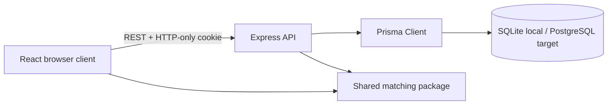

# Architecture

## Opportunity integration layer

`opportunity-routes.ts` orchestrates provider search, normalized Prisma storage, candidate matching, resume analysis, saving, tracking, and admin controls. `integrations/providers` contains Jooble, internal, and pending adapters; `integrations/services` owns normalization, URL safety, deduplication, and source status. See `JOB_AGGREGATOR.md`.

The React app uses TanStack Query for server state and route guards for role-aware navigation. Express validates input, authenticates signed JWT cookies, and scopes private records through the current user. Prisma maps users, role profiles, skills, jobs, requirements, applications, saved roles, and learning progress. The shared package contains the Zod contracts and pure matching function so the landing preview and authenticated results use identical logic.

Resume files live in `apps/api/storage/resumes`, outside public assets. Bounded uploads are signature-checked before local PDF/DOCX/TXT parsing. Prisma stores serialized analysis results for SQLite portability. Resume deletion cascades results and removes the private binary.
