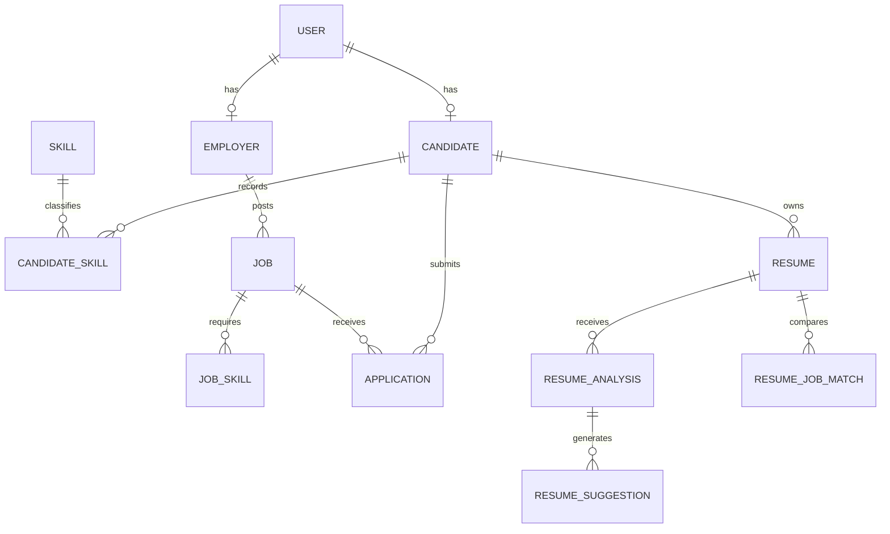

# Database

## External opportunities

`JobSource` owns `ExternalJob` and `JobSyncLog`. `ExternalJobSkill` links unverified extracted requirements to the shared taxonomy. Candidate-owned `ExternalJobMatch`, `SavedExternalJob`, and `ExternalApplicationTracker` records are indexed and ownership-protected. Source/external-ID and candidate/job pairs are unique.

Emails, normalized skills, storage keys, and join pairs are unique. Resume JSON fields use serialized text for SQLite portability. Candidate/resume chronology is indexed. Cascade relationships remove analyses, matches, and suggestions when a resume is deleted; the service separately removes the private file. Ownership is always derived server-side.
